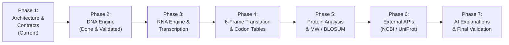
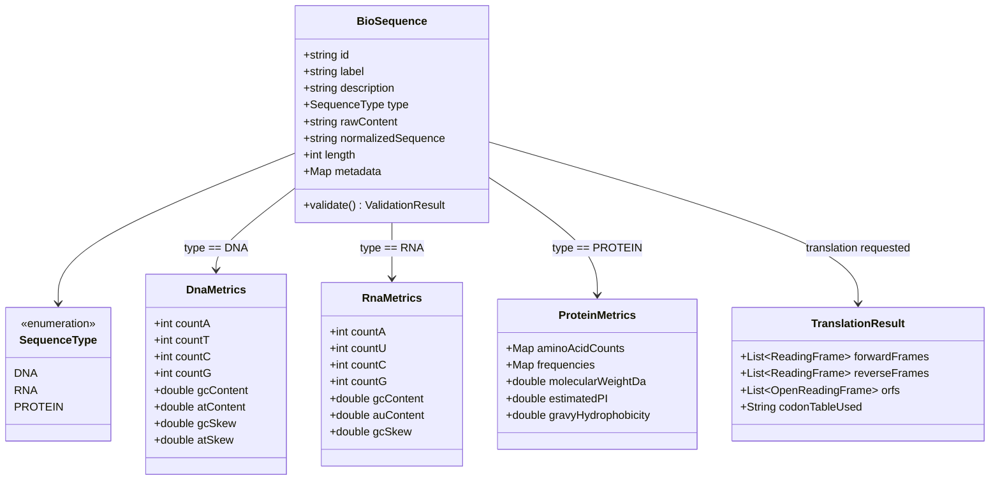

# Expanded Bioinformatics Architecture & Staged Implementation Roadmap

**Project Title:** Smart Bioinformatics Application for DNA Pattern Identification and Mutation Detection  
**Platform Scope:** Next.js Web Dashboard + Native Android App (Kotlin/Compose) + Shared Firebase Cloud  
**Expanded Modalities:** Deoxyribonucleic Acid (DNA), Ribonucleic Acid (RNA), and Polypeptide / Protein Sequences

---

## 1. Staged Implementation Roadmap



### Stage Breakdown & Milestones
- **Stage 1 (Current Milestone):** Architecture, polymorphic data model, API contracts, Firestore database schema, and verification test strategy.
- **Stage 2 (Completed):** DNA Analysis Engine (Needleman-Wunsch, IUPAC validator, GC/AT skew, motif finder, SNV/Indel classification, 20/20 unit tests passed).
- **Stage 3:** RNA Analysis Engine (Uracil handling, RNA secondary motif detection, transcription $T \longleftrightarrow U$, RNA-RNA alignment).
- **Stage 4:** 6-Frame DNA/RNA Translation Engine (Standard & Vertebrate Mitochondrial Codon Tables, forward frames $+1, +2, +3$, reverse-complement frames $-1, -2, -3$, Open Reading Frame (ORF) identification, stop codon handling).
- **Stage 5:** Protein Analysis Engine (20 canonical amino acids + ambiguous $B, Z, J, X$, molecular weight computation with water loss, isoelectric point $pI$ estimation, BLOSUM62 alignment, conservative vs. non-conservative substitution classification).
- **Stage 6:** External Database & BLAST Integration (NCBI BLAST REST API, UniProt protein annotation, ClinVar cross-referencing).
- **Stage 7:** Multi-Platform AI-Assisted Explanations (Structured biological insight generation, clinical disclaimers, evidence linking).
- **Stage 8:** Production Hardening & Native Android Parity (Android Compose screens for RNA/Protein/Translation, release APK signing, web deployment).

---

## 2. Polymorphic Sequence Data Model

To ensure strict scientific correctness, sequences are strongly typed and guarded against cross-contamination (e.g., GC% is strictly forbidden on protein sequences; amino acid substitutions are never labeled as DNA mutations).



---

## 3. Cloud Firestore Database Schema

The database schema is organized under a strict per-user multi-tenant hierarchy enforced by Firebase Security Rules:

```text
/users/{userId}
   ├── profile
   │     ├── displayName: string
   │     ├── email: string
   │     ├── institution: string
   │     ├── createdAt: timestamp
   │     └── preferences: { defaultCodonTable: "STANDARD", autoSuggestType: true }
   │
   ├── /projects/{projectId}
   │     ├── title: string ("BRCA1 Exon Variant Screening")
   │     ├── description: string
   │     ├── targetType: "DNA" | "RNA" | "PROTEIN" | "MIXED"
   │     ├── createdAt: timestamp
   │     │
   │     └── /sequences/{sequenceId}
   │           ├── header: string
   │           ├── type: "DNA" | "RNA" | "PROTEIN"
   │           ├── rawContent: string
   │           ├── length: number
   │           └── fastaRecordIndex: number
   │
   └── /analyses/{analysisId}
         ├── projectId: string (optional)
         ├── title: string
         ├── sequenceType: "DNA" | "RNA" | "PROTEIN"
         ├── analysisCategory: "METRICS" | "MOTIF" | "ALIGNMENT" | "TRANSLATION" | "BLAST"
         ├── querySequence: string
         ├── subjectSequence: string (optional)
         │
         ├── dnaResult: { ...DnaMetrics, alignment: { score, identity, mutations } }
         ├── rnaResult: { ...RnaMetrics, transcribedFrom: string }
         ├── proteinResult: { ...ProteinMetrics, blosumScore, identityPercent, substitutions }
         ├── translationResult: { frames: [...], orfCount: number }
         ├── externalAnnotations: { ncbiGeneId, uniProtId, clinVarStatus }
         ├── aiExplanation: { summary: string, biologicalSignificance: string, disclaimer: string }
         │
         ├── reportStorageUrl: string (Cloud Storage PDF path)
         ├── csvStorageUrl: string (Cloud Storage CSV path)
         └── createdAt: serverTimestamp()
```

---

## 4. API & Service Contracts

### 4.1 Sequence Type Suggestion & Validation Contract
```typescript
export type SequenceType = 'DNA' | 'RNA' | 'PROTEIN';

export interface ValidationResult {
  isValid: boolean;
  detectedType: SequenceType | 'AMBIGUOUS' | 'INVALID';
  suggestedType: SequenceType;
  cleanedSequence: string;
  invalidCharacters: string[];
  warnings: string[];
}
```

### 4.2 6-Frame Translation Contract
```typescript
export interface CodonTranslation {
  codon: string;
  aminoAcid: string; // 1-letter abbreviation, or '*' for stop
  name: string;
  position: number; // 1-based codon index
}

export interface ReadingFrame {
  frame: 1 | 2 | 3 | -1 | -2 | -3;
  strand: '+' | '-';
  proteinSequence: string;
  codons: CodonTranslation[];
  stopCount: number;
}

export interface OpenReadingFrame {
  frame: number;
  startNucleotide: number;
  endNucleotide: number;
  lengthNucleotides: number;
  lengthAminoAcids: number;
  proteinSequence: string;
  hasStartCodon: boolean; // Starts with Methionine (M / ATG / AUG)
  hasStopCodon: boolean;
}

export interface SixFrameTranslationResult {
  forwardFrames: [ReadingFrame, ReadingFrame, ReadingFrame]; // +1, +2, +3
  reverseFrames: [ReadingFrame, ReadingFrame, ReadingFrame]; // -1, -2, -3
  orfs: OpenReadingFrame[];
  codonTable: 'STANDARD' | 'VERTEBRATE_MITOCHONDRIAL';
}
```

### 4.3 Protein Characterization & BLOSUM Alignment Contract
```typescript
export interface ProteinMetrics {
  length: number;
  aminoAcidCounts: Record<string, number>;
  frequencies: Record<string, number>;
  molecularWeightDaltons: number; // Sum of amino acid residues - 18.015 * (N - 1)
  isoelectricPoint: number;       // Estimated pI based on pKa of N/C termini & side chains
  gravyIndex: number;             // Grand Average of Hydropathicity (Kyte-Doolittle)
}

export interface AminoAcidSubstitution {
  position: number;
  refResidue: string;
  altResidue: string;
  isConservative: boolean;        // BLOSUM62 score >= 0
  score: number;
  description: string;            // e.g. "p.Glu6Val"
}
```

---

## 5. Comprehensive Scientific Test Strategy

| Test Group | Benchmark Dataset | Verification Standard |
| :--- | :--- | :--- |
| **DNA Needleman-Wunsch** | Human *HBB* Exon 1 Normal vs. Sickle Cell | $99.68\%$ Identity, exact single transversion $c.20A>T$ ($p.Glu6Val$). |
| **DNA Indel Detection** | Synthetic 58bp benchmark | Accurate identification of $delTC$ and $insAAC$ with 1-based coordinates. |
| **RNA Transcription** | Coding DNA $\to$ mRNA | Exact $T \longleftrightarrow U$ conversion, preserving $5' \to 3'$ orientation. |
| **RNA GC-Metrics** | Yeast tRNA-Phe | Accurate base counts ($A, C, G, U$) and GC-content with Uracil handling. |
| **6-Frame Translation** | Human *HBB* mRNA ($309$ nt) | Frame $+1$ produces beta-globin polypeptide starting with Methionine (`MVHLTPEEKSAVTALWGKVNVDEVGGEALGRLLVVYPWTQRFFESFGDLSTPDAVMGNPKVKAHGKKVLGAFSDGLAHLDNLKGTFATLSELHCDKLHVDPENFR`). |
| **Protein Molecular Weight** | Human Insulin (A chain: 21 AA, B chain: 30 AA) | Calculated MW matches theoretical mass within $\pm 0.05$ Da including water loss condensation. |
| **Scientific Type Isolation** | Attempting GC% on Hemoglobin Protein (`MVHLTPEEK...`) | Validator throws `IllegalSequenceOperationError: GC% calculation cannot be performed on protein sequences`. |
| **Database Security Rule** | Unauthenticated Firestore Read/Write | Access denied; users can only read and write `/users/{uid}/analyses`. |

