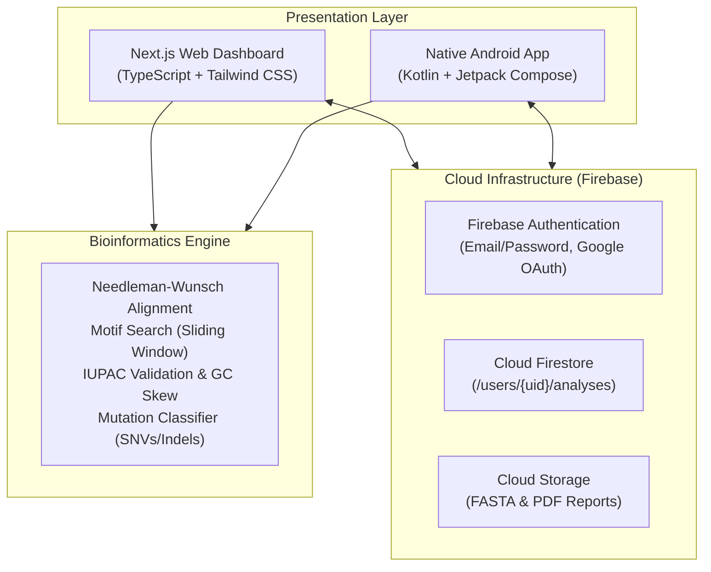

# System Architecture & Technical Specification

## Smart Bioinformatics Application for DNA Pattern Identification and Mutation Detection

### 1. High-Level Architecture



---

### 2. Multi-Tier Component Breakdown

| Component | Technology | Role & Key Features |
| :--- | :--- | :--- |
| **Web Dashboard** | Next.js 14, TypeScript, Tailwind CSS | Responsive desktop & tablet scientific UI; Interactive sequence inputs, drag-and-drop FASTA parser, color-coded alignment matrix, client-side PDF/CSV export. |
| **Android Application** | Kotlin, Jetpack Compose, Material 3, MVVM | **Genuine native Android app**; No WebViews; Material 3 Theme with Navy & Teal accents, Storage Access Framework for local FASTA loading, StateFlow & Coroutines. |
| **Bioinformatics Engine** | Dual TypeScript & Kotlin implementations | Algorithmic parity: IUPAC DNA validation, GC% and AT/GC skew, sliding window motif finder, Needleman-Wunsch global alignment, SNV/Indel classification. |
| **Cloud Backend** | Google Cloud Firebase | Firebase Auth for user management, Cloud Firestore for synchronized cross-platform history, Cloud Storage for FASTA datasets and PDF reports. |

---

### 3. Cloud Firestore Data Schema

```text
/users/{userId}
   ├── displayName: string
   ├── email: string
   ├── createdAt: timestamp
   │
   └── /analyses/{analysisId}
          ├── id: string (Document ID)
          ├── userId: string (Owner UID)
          ├── title: string ("Sickle Cell Anemia Analysis")
          ├── analysisType: string ("ALIGNMENT" | "METRICS" | "MOTIF")
          ├── sequenceLength: number
          ├── gcContent: number
          ├── atContent: number
          ├── refSequence: string
          ├── altSequence: string
          ├── refAligned: string
          ├── altAligned: string
          ├── identityPercent: number
          ├── mutationCount: number
          ├── mutationsSummary: string
          └── createdAt: timestamp (serverTimestamp)
```

---

### 4. Security Rules Specification

1. **Role-Based Ownership:** Users can strictly read, write, and delete **only their own** records (`request.auth.uid == userId`).
2. **Data Isolation:** Cross-user data leaks are prevented at the database kernel level by Firebase Security Rules.
3. **Storage Quotas:** File uploads are capped at 20MB for FASTA sequences and 10MB for PDF reports.

